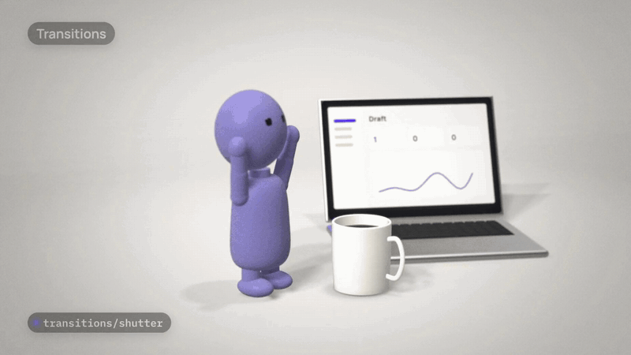
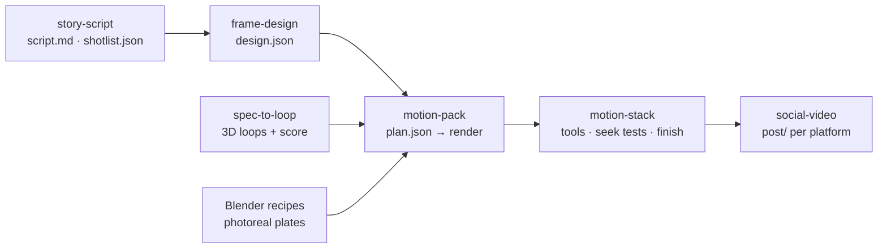

https://github.com/user-attachments/assets/917b9ebc-9679-49bf-b4c8-dc9a1663dead

<p align="center"><sub>The 46-second showcase film (sound on). An agent made every frame with this pack: Blender 3D, GL transitions, kinetic type, synthesised music and sound. Download: <a href="media/film.mp4"><code>media/film.mp4</code></a>.</sub></p>

<p align="center">
  <a href="media/promo.mp4"></a>
</p>

<p align="center"><sub>The first promo, also made with the pack. Click it for the <a href="media/promo.mp4">full 42-second MP4</a>.</sub></p>

<h1 align="center">motion-pack</h1>

<p align="center">
  <b>Open-source video parts and AI skills that take an agent from a prompt to a finished, beat-synced video.</b><br>
  Every frame is a pure function of time. Tested against 20 popular motion libraries. MIT code, CC0 sounds and music.
</p>

<p align="center">
  <a href="https://anveai.github.io/motion-pack/catalog/"><b>Browse the catalog</b></a> ·
  <a href="#quickstart-5-minutes">Quickstart</a> ·
  <a href="#the-skills">Skills</a> ·
  <a href="#lab-20-motion-libraries-tested">Lab results</a> ·
  <a href="#use-with-claude-code">Install in Claude Code</a>
</p>

---

AI agents can now write the code for a video. Making it *good* is still hard. You need:
- **a story** worth watching;
- **a look** that holds together;
- **motion and sound** cut to the beat;
- **a render** that comes out the same every time;
- **a post** that fits each platform.

**motion-pack gives an agent all five:**
- a library of deterministic parts: transitions, kinetic type, synthesised sound effects and music, finishing layers, camera moves, three.js objects, Blender recipes and genre templates;
- six connected skills that tell the agent which part to use, when, and how to check the result.

Everything renders with [HyperFrames](https://github.com/heygen-com/hyperframes) (HTML to MP4), a GPU-supersampled three.js studio, or Blender. Nothing in the pack is sampled, scraped or made by a paid model.

## Why "pure function of time" matters

Video renderers don't play your animation; they **seek** it. They ask for frame 0, then frame 1, sometimes frame 90 first, sometimes one chunk per worker.

Anything that depends on a clock, an animation loop, a running simulation or live audio looks right in a browser and goes wrong in the render. You get jitter, drift, a video layer one frame early, or sound that never reaches the file.

Every component here draws frame N from N alone. So you can:
- render out of order;
- re-render one shot;
- split work across machines;

and get the same pixels and the same audio every time. We tested exactly this against 20 popular motion libraries (below).

## The skills

Six skills, written in the open [Agent Skills](https://agentskills.io) format. Each one hands files to the next:



| skill | what it does |
|---|---|
| [`story-script`](skills/story-script/SKILL.md) | **Creative script writing** for short video: a protagonist with a stake, one turn, payoff. Beat sheets for 6–90 s, hook variants, shot lists, and a review rubric. |
| [`frame-design`](skills/frame-design/SKILL.md) | **Art direction for every frame:** tone and motion personality, a palette that passes WCAG contrast, type pairing, grids and safe zones, covers and thumbnails. |
| [`motion-pack`](skills/motion-pack/SKILL.md) | **Makes the video** from the pack's parts. A decision tree and recipes for ads, launch films, short films, character spots, talking-head edits, beat edits and Blender plates, plus virality and QA checklists. |
| [`spec-to-loop`](skills/spec-to-loop/SKILL.md) | **Frame-exact generative 3D loops with a scored soundtrack.** A binding spec, a GPU-supersampled render, and measured sound correction rounds. |
| [`motion-stack`](skills/motion-stack/SKILL.md) | **Picks, wires and proves the right open-source tool.** Tested verdicts on 20 motion repos, adapter code, a seek-test harness, and encode/cover/audio settings. |
| [`social-video`](skills/social-video/SKILL.md) | **Publishes and grows:** platform specs, copy per platform, covers, AI-disclosure settings, upload copies, and what to measure. |

The skills pair well with [charlie947/social-media-skills](https://github.com/charlie947/social-media-skills) (MIT, by Charlie Hills) for written posts.

## What's inside

<!-- counts:start -->
| module | what | read first |
|---|---|---|
| `transitions/` | 47 transitions: 23 with an exact DOM back-end, 23 WebGL with a DOM approximation, 1 timing-only (speed ramp); 140 aliases incl. 59 ffmpeg xfade modes | `transitions/README.md` |
| `cuts/` | 35 cut patterns (beat grids, sections, J/L splits, talking-head, story shapes, pace) + 3 rule sets + 6 retime presets | `cuts/README.md` |
| `sfx/` | 295 synthesised sounds in 25 families, 13 role bundles per video type | `sfx/README.md` |
| `music/` | 40 beds from 32 style presets, 10 stingers, 14 sonic logos, plus the mixer | `music/README.md` |
| `layers/` | 124 finishing components (overlays, grades, grain stocks, finisher) incl. 45 looks; 49 `.cube` LUTs | `layers/README.md` |
| `type/` | 145 kinetic-type presets, caption styles, icons, editor graphics and stickers | `type/README.md` |
| `camera/` | 45 2D and 3D camera moves | `camera/README.md` |
| `objects/` | 25 three.js props, set pieces and one rigged character | `objects/README.md` |
| `templates/` | 5 genre templates: ad, beat-edit, character-spot, film-scene, talking-head | `templates/README.md` |
| `blender/` | 7 Blender recipes for photoreal plates (4 product shots, 3 seamless art loops), 4 device presets, 8 showcase previews | `blender/README.md` |
| `physics/` | build-time rigid-body baking (Rapier) with a dependency-free table player; 2 example specs, 1 baked table | `physics/README.md` |
| `terminal/` | 5 baked flock looks (cbirds, fetched and built at a pinned commit): flock, braille, a word the flock writes, 3D murmuration, code that flies | `terminal/README.md` |

The catalog lists **821** browsable components. Counts generated by `python3 tools/count.py`.
<!-- counts:end -->

Every module has a README with its API, measured numbers and honest limits. Modules reference each other by id (`transitions/whip`, `sfx/whoosh/swish_s`, `music/bed_tech_pulse_loop8`, `type/scaleSlam`, `objects/laptop`, `blender/turntable`), and `python3 tools/check_ids.py` resolves every one.

## Quickstart (5 minutes)

| need | for |
|---|---|
| Node.js 22+ | HyperFrames renders, templates, tests |
| Python 3.11 + `pip install -r requirements.txt` | sound synthesis, mixing, cuts, catalog |
| ffmpeg | mixes, muxing, contact sheets, encodes |
| Chrome or Chromium | HyperFrames and three.js renders |
| A hardware GPU | WebGL templates and transitions |
| Blender 5.2 (optional) | photoreal plates in `blender/` |

```bash
git clone https://github.com/ANVEAI/motion-pack && cd motion-pack
pip install -r requirements.txt

# 1. Build the sound library (or download the WAV masters from the latest Release)
python3 sfx/build_library.py         # every synthesised sound → sfx/library/ (under a minute)
python3 music/build_music.py         # beds, stingers, sonic logos → music/library/ (1–2 minutes)

# 2. Make a 15-second ad: plan, SFX + music mix, HyperFrames page
cd templates/ad && node make.mjs --set length=15

# 3. Render it
npx --yes hyperframes@0.8.142 render . -o out/ad-15.mp4 --crf 23
```

To make your own video:
1. Copy the closest template folder.
2. Edit only the `CONFIG` block in its `config.mjs`.
3. Keep every reference as an id.

`python3 tools/check_ids.py` should report 0 unresolved.

## Worked example: one prompt, 31 minutes

[`examples/brewly-teaser/`](examples/brewly-teaser/README.md) is a real, unedited agent run. The prompt was:

> "Make a 15-second 9:16 launch teaser for Brewly, a fictional coffee-subscription app … then draft the X post."

The agent went through all the skills, from script to design, plan, render, QA and post. It produced a 9:16 teaser, a 16:9 re-layout and an X post draft. The full `RUNLOG.md` shows every command, every mistake and every fix.

## Use with Claude Code

The repository is a Claude Code plugin and marketplace:

```text
/plugin marketplace add ANVEAI/motion-pack
/plugin install motion-pack@anve
```

Then ask for a video ("make a 30-second launch ad for my app") and the skills load on their own. Run Claude Code from a clone of this repo, because renders and audio builds happen in the clone.

**Manual install** (any project, without the plugin system):

```bash
for s in skills/*/; do ln -s "$PWD/${s%/}" ~/.claude/skills/; done
```

**Other agents:** the skills are plain folders with a `SKILL.md`. Agents that read the Agent Skills format can load them directly (the [client list](https://agentskills.io/clients) includes Codex, Gemini CLI, Cursor, GitHub Copilot, OpenCode and Goose). Everything else works through files and command-line scripts: no server, no API key.

## Lab: 20 motion libraries tested

We installed a widely shared list of 20 motion repos, plus cbirds for terminal looks, and built the same shots with each. Then we measured whether each one survives seek-based rendering: the same frame twice, any seek order, a cold page, and a real production render. **75 variants:** 7 adopted, 20 for niches, 10 where what we had already won, 38 rejected.

| job | what passed | what didn't |
|---|---|---|
| 2D motion | **GSAP** (bit-exact with two settings), plain functions of t | Motion (built for live UI), Motion Canvas and Remotion (heavier, nothing gained) |
| 3D | **three.js, pinned**, with a supersampled post chain; pmndrs `postprocessing` as a tail pass | React Three Fiber (same pixels, 6x the dependencies); upgrading three mid-project |
| Physics | **Rapier baked at build time** (byte-identical tables) | live `@react-three/rapier` (fails the seek-order gate) |
| Lottie | **lottie-web** through HyperFrames' adapter | dotLottie through the adapter (blank video; use a bridge); Rive (needs its editor) |
| Icons | **SVGO** with a draw-on-safe config (−30.7%) | SVGO's default preset (fuses strokes, breaks draw-ons) |
| Encoding | **ffmpeg x264 two-pass** | WebCodecs H.264 for finals (1–3 dB worse; great for drafts) |
| Sound | declared audio or an offline mix | Howler (live audio never reaches the file) |
| Terminal / ASCII | **cbirds baked into a plate** (byte-identical bakes; 300/300 frame identity as a HyperFrames video layer) | screen-recording cbirds in a terminal (wall-clock steps: 3 runs, 3 different frames) |

The full write-ups, contact sheets and every number are in [`lab/`](lab/README.md), and the harness ships in [`skills/motion-stack`](skills/motion-stack/SKILL.md).

Along the way we reported an easing bug upstream: [heygen-com/hyperframes#5538](https://github.com/heygen-com/hyperframes/issues/5538).

## The catalog

<https://anveai.github.io/motion-pack/catalog/> shows every component with a preview, its parameters and its pairings (which sound goes with which transition, which bed with which bundle). It also works offline: open `catalog/index.html` from disk, or run `python3 -m http.server` in the repo root and visit `/catalog/`.

## Heavy media: regenerate or download

The git tree carries code, manifests and small previews. Full-size media is either rebuilt bit for bit by the pack's scripts or attached to each GitHub Release:

| media | regenerate | Release asset |
|---|---|---|
| Sound effects (WAV, 48 kHz, 24-bit) | `python3 sfx/build_library.py` | `motion-pack-sfx-wav-<version>.zip` |
| Music beds, stingers, sonic logos (+ beat-grid sidecars) | `python3 music/build_music.py` | `motion-pack-music-wav-<version>.zip` |
| Full-size renders and contact sheets | the module's sheet script | `motion-pack-renders-fullres-<version>.zip` |
| Demo mixes and stems | `music/demo/demo_mix.py`, `sfx/demo/demo_sfx_reel.py` | `motion-pack-demo-audio-<version>.zip` |

Each Release lists `SHA256SUMS`. The MP3 previews in git are for listening only: MP3 adds encoder delay, so anchors and mixing use the WAV masters.

## Optional third-party sets

Nothing third-party is vendored. `scripts/fetch-external.sh` downloads pinned, permissively licensed sets from their original sources and checks every file against `scripts/external.lock`:
- Lucide and Phosphor icons;
- Fluent Emoji;
- Kenney and OwlishMedia CC0 audio.

Audio enters the sound catalogue only through `sfx/tools/check_origin.py` and `catalog_import.py`. Optimise icons once with `npx svgo@4.1.0 --config scripts/svgo.config.mjs`. `terminal/fetch-cbirds.sh` builds cbirds (MIT) from a pinned, checksummed source tarball for the baked flock looks in `terminal/`. See [THIRD_PARTY.md](THIRD_PARTY.md).

## Checks

| check | command |
|---|---|
| Ids resolve across modules | `python3 tools/check_ids.py` |
| Python (cuts, sfx, music, refstudy) | `python3 -m pytest -q cuts/test_cutgen.py cuts/test_retime.py sfx/tests music/tests tools/tests` |
| Study a reference video | `python3 tools/refstudy.py <url-or-mp4> refs/<name> --whisper none` (`skills/motion-pack/references/reference-intake.md`) |
| Critic evidence for a render | `bash tools/critic_pack.sh out/film.mp4 reviews/r1 [composition_dir]` (`skills/motion-pack/references/critic.md`) |
| Transitions core + lint | `node transitions/tests/core.test.mjs && node transitions/tools/lint.mjs` |
| Camera maths | `node camera/tests/camera.test.mjs` |
| Physics player | `node physics/tests/test-player.mjs` |
| Any page is seek-safe | `node skills/motion-stack/scripts/seekcheck.mjs page.html` |
| Browser tests on a real GPU | `bash layers/tests/run-all.sh` |
| Terminal bake is reproducible | `bash terminal/tests/smoke.sh` |

CI runs the checks that need no GPU on every push.

## Licences

- **Code, shaders and skills:** MIT, see [LICENSE](LICENSE). Copyright (c) 2026 Anveshana Futurecorp Pvt Ltd (ANVE).
- **Media the pack generates** (synthesised SFX and music, renders and previews, images, LUT `.cube` files): CC0 1.0, see [LICENSE-MEDIA](LICENSE-MEDIA). Use them in anything, with no credit line.
- **Fonts** (Manrope, IBM Plex Mono): SIL Open Font License 1.1, with the licence text next to each font.
- **Trademarks:** the ANVE name and logo are not covered by either licence, see [TRADEMARKS.md](TRADEMARKS.md).
- **Third-party:** runtime libraries and the optional fetched sets keep their own licences, see [THIRD_PARTY.md](THIRD_PARTY.md).

## Credits

Made by [ANVE](https://anveai.com). The pack grew out of producing our own launch films with AI agents. Ideas were read, cited and re-implemented, never copied:
- the GL Transitions collection (credited per transition in `transitions/catalog.json`);
- Walter Murch's *In the Blink of an Eye*;
- ITU-R BS.1770 / EBU R128 loudness metering;
- the edit-grammar and platform research cited in `docs/research/`.

## Contributing

Issues and pull requests are welcome; see [CONTRIBUTING.md](CONTRIBUTING.md). The short version:
- keep every component a pure function of time;
- reference other modules by id;
- run the checks;
- never commit third-party media.
