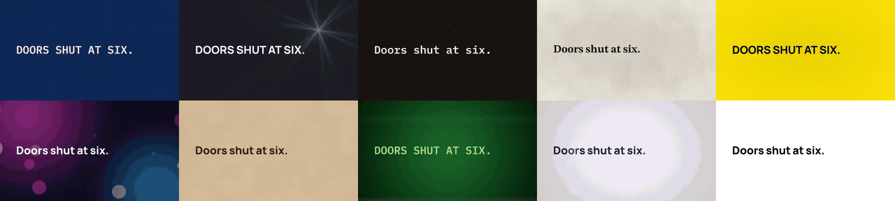
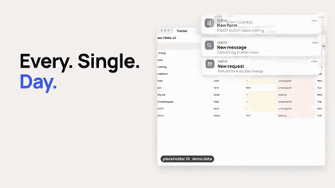
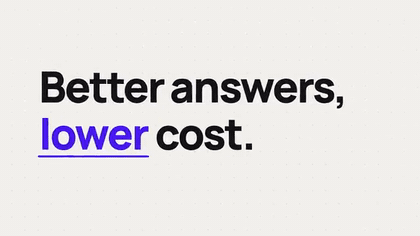
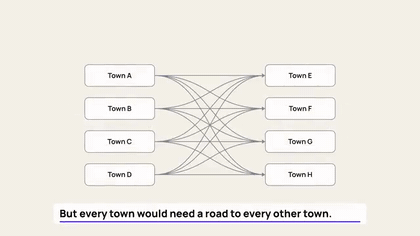

<p align="center"><a href="https://anveai.github.io/motion-pack/catalog/#styles"></a></p>

<h1 align="center">motion-pack</h1>

<p align="center"><b>告诉你的编程智能体想要什么样的片子，直接拿到带音乐、音效和字幕的成片 MP4。</b><br>
<!--n:playbook_styles-->10<!--/n--> 种命名风格 · <!--n:playbook_formats-->14<!--/n--> 种片型 · <!--n:catalog_total-->1163<!--/n--> 个开源组件 · 每一帧都只由时间决定 · 代码 MIT，音效与配乐 CC0</p>

<p align="center">
  <a href="https://anveai.github.io/motion-pack/catalog/#styles"><b>▶ 观看风格样片</b></a> ·
  <a href="#复制这段提示词">复制提示词</a> ·
  <a href="docs/prompts.md">提示词库</a> ·
  <a href="README.md">English</a> ·
  <a href="#安装">安装</a>
</p>

<p align="center">
  <a href="media/films/launch-film.mp4"></a>
  <a href="media/films/proof-clip.mp4"></a>
  <a href="media/films/explainer.mp4"></a>
</p>

<p align="center"><sub>上图：同一支 10 秒占位广告，分别用全部 <!--n:playbook_styles-->10<!--/n--> 种风格渲染。下方：v0.5 验证运行中的发布片、证明片和讲解片（占位品牌、示例数据）。每一支都由智能体用本工具包完成规划、渲染和检查。点击可看 MP4。</sub></p>

## 复制这段提示词

安装插件（见下文），在任意文件夹打开 Claude Code，粘贴：

```text
用 Blueprint（蓝图）风格，为 <你的产品> 做一支 10 秒 16:9 的广告：一句钩子、问题、产品亮相、一句佐证，片尾卡写产品名和行动号召。要有音乐和音效。最后跑一遍检查。
```

智能体接下来会运行：

```bash
sh skills/motion-pack/scripts/find-pack.sh            # PACK=...：MOTION_PACK_HOME、~/.motion-pack/<版本>，或 `mp init`（校验 SHA256）
mp brief "<你的提示词>" --style blueprint --out work/   # 选片型，写出 research-pack.md、plan.json、project.json
mp new ad work/film --project work/project.json        # 你的项目文件夹，放在工具包之外
mp render --dir work/film                              # renders/ad-16x9.mp4 + 联系表 + 响度
mp lint work/film/renders/ad-16x9.mp4                  # 逐条检查规则和风格特征，直到没有 FAIL
```

风格可以换成 <!--n:playbook_styles-->10<!--/n--> 种中的任意一种（`mp styles`，加 `--zh` 显示中文），片型也可以换成发布片、证明片、讲解片或新功能片。[提示词库](docs/prompts.md)里有 <!--n:gallery_prompts-->29<!--/n--> 条经过测试的提示词，每条对应一个片型与风格的组合。同一条提示词每次运行都会做出不同的片子。

## 为什么用这个工具包

- **确定性。** 每一帧都是时间的纯函数：任何一帧都能按任意顺序、在任意数量的进程里重新渲染出同样的画面。
- **有检查。** `mp lint` 用 <!--n:playbook_rules-->338<!--/n--> 条分级规则（开头钩子、安全区、对比度、阅读时长、响度）和风格特征，检查规划和最终交付的文件。
- **CC0。** 工具包生成的音效、配乐和渲染都是 CC0，代码是 MIT。没有采样、没有抓取，也没有用付费模型。

## 风格

| 风格 | 它看起来、听起来是什么样 | 样片 |
|---|---|---|
| `blueprint` 蓝图 | 一张技术图纸：制图蓝上的等宽字，信号黄，先描边再填色。 | [10 秒 MP4](media/styles/blueprint.mp4) |
| `chrome-product` 铬金属产品 | 石墨色舞台，银色文字，冰蓝光芒：高端产品揭晓。 | [10 秒 MP4](media/styles/chrome-product.mp4) |
| `documentary-grain` 纪录片颗粒 | 16 毫米胶片的温度：深棕底上的米色字，琥珀点缀，胶片颗粒、灰尘与暖色漏光。 | [10 秒 MP4](media/styles/documentary-grain.mp4) |
| `editorial-print` 编辑印刷 | 会动的杂志版面：暖色新闻纸上的衬线大标题，一抹红，网点质感。 | [10 秒 MP4](media/styles/editorial-print.mp4) |
| `kinetic-poster` 动态海报 | 一张响亮的海报：信号黄上猛砸的巨大黑字，一抹钴蓝，踩点甩镜。 | [10 秒 MP4](media/styles/kinetic-poster.mp4) |
| `neon-night` 霓虹之夜 | 夜城光晕：深靛蓝上的亮色字，洋红点缀，散景光斑，合成器浪潮配乐。 | [10 秒 MP4](media/styles/neon-night.mp4) |
| `paper-cut` 剪纸拼贴 | 牛皮纸与瓦楞纸，一抹深青，弹跳字效与翻页转场：手作感。 | [10 秒 MP4](media/styles/paper-cut.mp4) |
| `retro-crt` 复古显像管 | 一台老终端：荧光绿等宽字，琥珀点缀，扫描线、磁带抖动与芯片音乐。 | [10 秒 MP4](media/styles/retro-crt.mp4) |
| `soft-clay` 柔软黏土 | 棚拍光下的圆润黏土 3D：淡紫底，友好的紫色，弹跳的低保真配乐。 | [10 秒 MP4](media/styles/soft-clay.mp4) |
| `swiss-grid` 瑞士网格 | 白底黑色无衬线字，一抹信号红，踩点硬切：信息即设计。 | [10 秒 MP4](media/styles/swiss-grid.mp4) |

`mp styles <id>` 会打印该风格的提示词、调色板（已做对比度检查）、字体、运动方式、转场、声音和所用组件；`mp plan <片型> --style <id>` 把风格叠加到任意片型上。完整表格见 [`playbook/README.md`](playbook/README.md#styles)。

## 安装

在 Claude Code 里：

```text
/plugin marketplace add ANVEAI/motion-pack
/plugin install motion-pack@anve
```

之后在任意文件夹里提出做视频的需求，技能会自动加载。技能用 `skills/motion-pack/scripts/find-pack.sh` 找到工具包：先看你设置的 `MOTION_PACK_HOME`（一个克隆），再看 `~/.motion-pack/<版本>`，都没有就运行 `mp init`：从 GitHub 下载该版本的发布压缩包，对照发布页的 `SHA256SUMS` 校验通过后才解压到 `~/.motion-pack/<版本>`。你的项目文件夹留在你工作的地方；渲染和音效库构建发生在工具包文件夹里，不会写进插件缓存。

需要 Node 22+、ffmpeg、Chrome 和 Python 3.11（3.10 到 3.12 能装上固定版本，3.13 及以上不行）。第一次做片前构建一次音效库：`python3 sfx/build_library.py && python3 music/build_music.py`。

## 其余部分（英文 README 的摘要）

- **它是什么：** 一套给 AI 智能体用的确定性视频组件，加上六个相互衔接的技能（story-script 写剧本、frame-design 做美术指导、motion-pack 出片、motion-stack 选库与验证、spec-to-loop 做 3D 循环、social-video 发布）。全部用 [HyperFrames](https://github.com/heygen-com/hyperframes)（HTML 转 MP4）、超采样的 three.js 或 Blender 渲染。
- **为什么“时间的纯函数”很重要：** 渲染器是“跳帧”取画面的，依赖时钟、动画循环或实时音频的东西在浏览器里看着对，渲染出来就会抖动、错位或丢声音。英文 README 的 “What is and is not deterministic” 一节如实写了哪些是逐字节一致的（规划、混音、音频），哪些只在 GPU 噪声范围内一致（画面）。
- **组件清单：** 转场、剪辑模式、合成音效与配乐、成片图层与调色、动态字体、摄像机运动、three.js 物体、Blender 配方、物理烘焙、类型模板、ears（自动听）、eyes（自动看）、分镜、playbook（规则、片型与风格）。数量由 `python3 tools/count.py` 生成，见英文 README 的 “What's inside” 表。
- **实验室：** 我们实测了 20 个热门动效库在跳帧渲染下是否稳定，结论和数字在 [`lab/`](lab/README.md)。
- **目录网站：** <https://anveai.github.io/motion-pack/catalog/>，现在第一个标签页是“风格”，第二个是“片型样片”，每项都带预览和可复制的提示词。
- **大文件：** WAV 音效库和配乐库不进 git，用构建脚本按当前代码逐位重建；每个发布版本也附带对应的压缩包和 `SHA256SUMS`。
- **许可：** 代码 MIT；工具包生成的媒体 CC0；随包字体为 SIL OFL 1.1；ANVE 名称与标志是商标。详见英文 README 的 Licences 一节。
- **参与贡献：** 见 [CONTRIBUTING.md](CONTRIBUTING.md)：每个组件都必须是时间的纯函数，模块之间用 id 引用，提交前跑检查，不提交第三方媒体。
